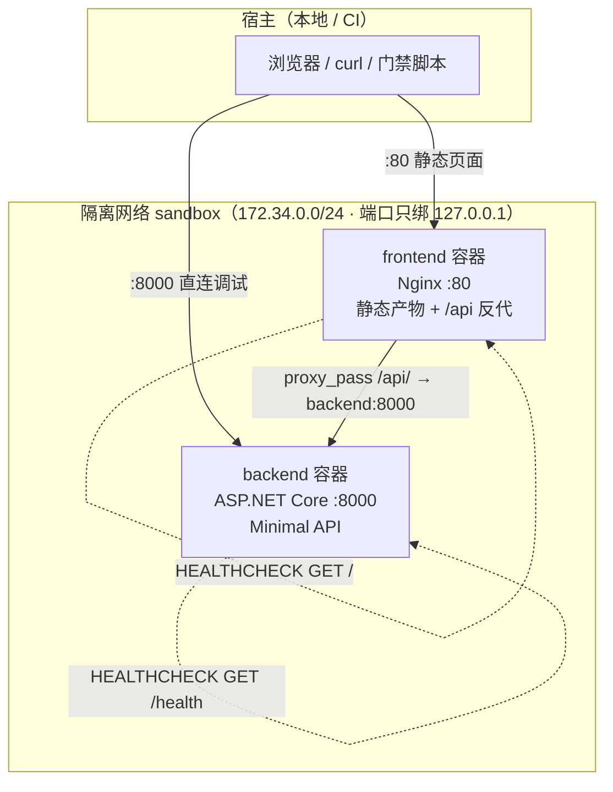

# 架构设计 — .NET + Vue 最小示例工程（模板）

> 本文是架构师角色的产出物，须在编码前定稿。前后端智能体只依据本文 + `api-spec.yaml` 并行开发。

## 1. 技术选型

| 层 | 技术 | 版本 | 理由 |
|---|---|---|---|
| 后端运行时 | ASP.NET Core Minimal API | .NET 8（LTS） | 官方长期支持版；Minimal API 样板代码极少，适合智能体生成的短小入口 |
| 后端语言 | C# 12 | 随 .NET 8 | 主构造函数、集合表达式等语法降低代码量；`Nullable enable` 消除空引用隐患 |
| 后端测试 | xUnit + `Microsoft.AspNetCore.Mvc.Testing` | 2.x / 8.0.x | `WebApplicationFactory<Program>` 可内嵌启动整个 API，无需外部进程 |
| 前端框架 | Vue 3 + TypeScript | 3.4 / 5.5 | 组合式 API 类型推导友好；生态成熟，模板与 `vue-go` 保持一致 |
| 前端构建 | Vite | 5.x | 冷启动快，内置 dev server 代理，降低联调成本 |
| 前端测试 | Vitest + Vue Test Utils + `@vitest/coverage-v8` | 2.x | 与 Vite 同源配置，覆盖率门槛可直接写进 npm script |
| 网关/静态托管 | Nginx | 1.27-alpine | 托管前端产物并把 `/api/` 反代到后端，避免浏览器直连跨域 |
| 容器化 | Docker 多阶段构建 | — | 构建与运行分离，运行镜像仅含 runtime，体积小、攻击面小 |
| 编排 | Docker Compose | — | 一键起停隔离环境，符合框架 §7 五重隔离要求 |

## 2. 系统架构图

调用链说明：

1. 生产形态下浏览器只访问 Nginx（80 端口），由 Nginx 把 `/api/` 反代给后端，同源无跨域。
2. 开发形态下 Vite dev server（3000）把 `/api` 代理到 `localhost:8000`，效果等价。
3. 后端不访问任何外部服务/数据库，因此隔离环境无需 Mock 服务即可闭环。

## 3. 模块划分

| 模块 | 路径 | 职责 | 责任角色 | 可改范围 |
|---|---|---|---|---|
| 后端入口 | `backend/Program.cs` | 构建 WebApplication、注册 CORS、映射路由、启动监听 | 后端智能体 | 仅 `backend/` |
| 后端单元测试 | `backend/tests/` | 覆盖 `/health`、`/api/v1/greeting` | 后端智能体（边写边测） | 仅 `backend/tests/` |
| 后端镜像 | `backend/Dockerfile` | 多阶段构建、非 root、HEALTHCHECK | 后端智能体 + 运维 | 仅本文件 |
| 前端入口 | `frontend/src/main.ts` | 挂载 Vue 应用 | 前端智能体 | 仅 `frontend/` |
| 前端视图 | `frontend/src/App.vue` | 渲染问候语 / 错误 / 加载三态 | 前端智能体 | 仅 `frontend/` |
| 前端 API 客户端 | `frontend/src/api.ts` | 唯一出网出口，对应契约 | 前端智能体 | 仅 `frontend/` |
| 前端测试 | `frontend/src/*.test.ts` | 覆盖 api 客户端与视图两态 | 前端智能体（边写边测） | 仅 `frontend/` |
| 网关配置 | `frontend/nginx.conf` | 静态托管 + `/api/` 反代 | 运维 | 仅本文件 |
| 隔离编排 | `deploy/docker-compose.yml` | 网络/资源/安全/健康检查 | 运维 | 仅 `deploy/` |
| 命令契约 | `scripts/*.sh` | 门禁 1–5 统一入口 | 运维/编排器 | 仅 `scripts/` |

> 边界原则：前端智能体**不得**修改 `backend/`，后端智能体**不得**修改 `frontend/src/`。
> 契约变更只能通过修改 `docs/api-spec.yaml` 并触发双方评审，不允许单方面改字段名。

## 4. 数据模型

本示例无持久化存储，仅有两组**传输对象（DTO）**，后端用 `record` 定义，前端用 `interface` 定义，
二者必须与 `api-spec.yaml` 的 schema 逐字段一致。

### 4.1 HealthResponse

| 字段 | 类型 | 必填 | 说明 |
|---|---|---|---|
| `status` | string | 是 | 固定 `ok`；非 `ok` 视为不健康 |

### 4.2 GreetingResponse

| 字段 | 类型 | 必填 | 说明 |
|---|---|---|---|
| `message` | string | 是 | 固定 `Hello from .NET backend` |
| `time` | string (date-time) | 是 | 服务端 UTC 时间，`DateTime.UtcNow.ToString("O")` 输出（ISO-8601 往返格式，带 `Z`） |

序列化约定：

- 使用 `System.Text.Json` 默认的 camelCase 命名策略，C# 属性 `Message` → JSON `message`。
- `time` 为**字符串**而非数值时间戳，避免前端时区/精度歧义。

## 5. 接口契约

完整契约见 [`api-spec.yaml`](./api-spec.yaml)（OpenAPI 3.0.3），要点：

| 方法 | 路径 | 成功响应 | 说明 |
|---|---|---|---|
| GET | `/health` | `200` `{"status":"ok"}` | 容器 HEALTHCHECK 与 `scripts/health.sh` 共同依赖 |
| GET | `/api/v1/greeting` | `200` `{"message":"Hello from .NET backend","time":"<ISO-8601>"}` | 前端唯一数据来源 |

契约纪律（硬性）：

1. 契约文件是**唯一事实源**，代码与契约不一致时以契约为准并立即修复代码。
2. 路径带 `/api/v1` 版本前缀，为后续不兼容变更保留并存空间。
3. CORS 在开发期放行任意来源，生产收敛到白名单（由网关实现，本模板不配置）。

## 6. 非功能设计

| 维度 | 设计 |
|---|---|
| 安全 | 后端容器以非 root 用户 `appuser` 运行；`read_only: true` + `tmpfs: /tmp`；`no-new-privileges:true`；无密钥入库，环境变量仅注入 `ASPNETCORE_URLS` / `ENV` |
| 资源限额 | backend `cpus 0.5 / memory 256M`，frontend `cpus 0.5 / memory 128M` |
| 网络隔离 | 独立网段 `172.34.0.0/24`，不与宿主其他项目互通；端口只绑 `127.0.0.1`，局域网不可达 |
| 健康检查 | 容器内 `HEALTHCHECK` 每 10s 探测 `/health`；编排另加 `depends_on` 顺序保证 |
| 可观测性 | 后端输出标准输出日志（容器日志采集即可）；`/health` 作为存活指标 |
| 性能 | Minimal API 无中间件冗余；单实例冷启动 < 2s；本示例不设 SLA，压测门禁留待业务项目补充 |
| 可维护性 | 全量中文注释；`scripts/` 隔离技术栈细节，新增 Java/.NET 变体不影响编排器 |
| 可测试性 | 后端 `public partial class Program` 使 `WebApplicationFactory<Program>` 可用；前端 api 层与视图层分离，便于 mock |
