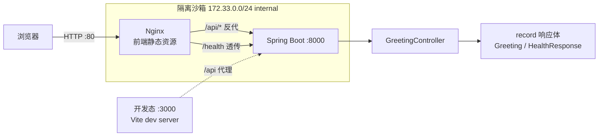

# 架构设计 — Java + Spring Boot 最小示例工程

> 版本：v0.1.0　｜　阶段：架构设计（流水线阶段 1）　｜　负责人：架构师智能体
> 门禁：契约（`docs/api-spec.yaml`）与本文档、与前后端实现三者必须一致。

## 1. 技术选型

| 层 | 技术 | 版本 | 选型理由 |
|---|---|---|---|
| 语言/运行时 | Java | 21（LTS） | 长期支持，record/sealed/虚拟线程可直接用，生态成熟 |
| 后端框架 | Spring Boot | 3.3.x | 企业级事实标准，起步依赖齐全，内嵌 Tomcat 免外部容器 |
| 构建工具 | Maven | 3.9 | 约定优于配置，`pom.xml` 单文件即可复现构建 |
| 接口风格 | REST + JSON | — | 与另两个模板保持同一契约语义（`message` + `time`） |
| 前端 | React + TypeScript | 18 / 5.5 | 与 `react-python` 模板同构，便于复用前端智能体经验 |
| 前端构建 | Vite | 5.x | 冷启动快，dev 代理配置简单 |
| 前端测试 | Vitest + Testing Library | 2.x | 原生 ESM，无需额外转译配置 |
| 后端测试 | JUnit 5 + MockMvc | Spring Boot Test | `@WebMvcTest` 只装 Web 层，毫秒级反馈 |
| 部署 | Docker 多阶段构建 + Nginx | 24 / 1.27 | 构建与运行分离，运行镜像只含 JRE |
| 编排 | Docker Compose | — | 单机即可拉起隔离沙箱，用完即销毁 |

> 备选方案取舍：Gradle 构建更快但示例项目用 Maven 更贴近存量 Java 团队；Undertow 替换 Tomcat 收益不明显，保持默认 Tomcat 以降低理解成本。

## 2. 系统架构图



**请求链路**：浏览器 → Nginx（静态资源 + 反代）→ Spring Boot（DispatcherServlet → GreetingController）→ 返回 JSON。

## 3. 模块划分

| 模块 | 路径 | 职责 | 可修改者 |
|---|---|---|---|
| 启动层 | `backend/src/main/java/com/example/demo/DemoApplication.java` | 装配 Spring 容器、读取 `PORT` 决定监听端口 | 后端 |
| 接口层 | `backend/.../api/GreetingController.java` | 路由、参数、响应结构；不含业务状态 | 后端 |
| 契约层 | `docs/api-spec.yaml` | 唯一事实源，字段变更先改这里 | 架构师 |
| 后端测试 | `backend/src/test/java/.../GreetingControllerTest.java` | 接口级单测（正常/异常路径） | 后端 |
| 前端视图 | `frontend/src/App.tsx` | 加载态、成功态、失败态三态渲染 | 前端 |
| 前端客户端 | `frontend/src/api.ts` | 统一 fetch 封装与 TS 类型，与契约对齐 | 前端 |
| 前端测试 | `frontend/src/*.test.tsx、*.test.ts` | 组件与客户端单测 | 前端 |
| 编排 | `deploy/docker-compose.yml` | 网络/资源/安全基线 | 运维 |
| 命令契约 | `scripts/*.sh` | 门禁统一入口 | 运维 |

**分层约束**：Controller 不直接依赖外部服务；前端不硬编码后端地址（统一走相对路径 `/api`，由代理/反代转发）。

## 4. 数据模型

本期无持久化层，仅两个不可变响应模型（Java `record`）：

```java
// 健康检查响应
record HealthResponse(String status)          // status 恒为 "ok"

// 问候响应
record Greeting(String message, String time)  // time = Instant.now().toString()
```

对应的 JSON：

```json
{ "status": "ok" }
{ "message": "Hello from Java backend", "time": "2026-11-20T08:00:00.123456Z" }
```

前端 TS 类型与之一一对应（`frontend/src/api.ts` 中的 `Health`、`Greeting`）。

> 扩展约定：若未来引入数据库，模型放在 `api/`（DTO）与 `domain/`（实体）两层，DTO 不得直接暴露实体字段。

## 5. 接口契约说明

完整定义见 [api-spec.yaml](./api-spec.yaml)。要点：

| 接口 | 方法 | 成功码 | 响应字段 | 错误码 |
|---|---|---|---|---|
| `/health` | GET | 200 | `status: string` | — |
| `/api/v1/greeting` | GET | 200 | `message: string`、`time: string(date-time)` | 405（方法不允许） |

- **版本化**：业务接口统一 `/api/v1/` 前缀，破坏性变更升 `v2`，不在 `v1` 上删字段。
- **时间语义**：`time` 统一 UTC ISO-8601，前端只做展示，不做时区换算假设。
- **错误约定**：非 2xx 时前端抛 `请求失败: <status>`，页面展示该文案；后端不返回堆栈。
- **契约门禁**：CI 与评审阶段比对 `api-spec.yaml` 与 Controller 注解、前端类型，三者不一致即退回。

## 6. 非功能设计

### 6.1 安全

- 容器运行用户为非 root（Dockerfile 中 `useradd` + `USER app`）。
- 根文件系统 `read_only: true`，仅 `/tmp`（后端）、Nginx 缓存与 `run` 目录（前端）为 tmpfs。
- `security_opt: no-new-privileges:true`，阻断提权。
- 不注入任何生产凭证；`ENV=staging` 仅作标识。
- Nginx 附加 `X-Content-Type-Options`、`X-Frame-Options`、`Referrer-Policy` 响应头。

### 6.2 网络隔离

- Compose 网络 `internal: true`，容器不可访问外网，只在 `172.33.0.0/24` 内互通。
- 仅映射 8000/80 到宿主机供本地调试；纯闭环场景可删除 `ports`。

### 6.3 资源与稳定性

- 后端限额 0.5 CPU / 512M，前端 0.5 CPU / 256M，防止单个容器拖垮宿主机。
- 健康检查：后端 `curl /health`（`start_period: 40s` 覆盖 JVM 启动），前端 `wget /`。
- 前端 `depends_on: condition: service_healthy`，后端未就绪不启动前端。

### 6.4 可观测性

- 健康探针：`/health`（存活）；日志输出到容器 stdout，由 `docker logs` 采集。
- 关键指标建议：请求数/错误率、P95 延迟、JVM 堆使用、容器 CPU/内存（详见 `runbook.md` §5）。

### 6.5 可测试性

- 后端：`@WebMvcTest` + MockMvc，不启动完整上下文，单测可在 10s 内跑完。
- 前端：Vitest + jsdom，`fetch` 用 `vi.fn()` 打桩，测试不依赖真实后端。
- 统一入口：`scripts/test.sh` 串行执行两端单测，任一失败即非 0 退出。

### 6.6 构建与发布

- 多阶段构建：`maven:3.9-eclipse-temurin-21` 编译 → `eclipse-temurin:21-jre` 运行，最终镜像不含源码与构建工具。
- 前端：`node:20-alpine` 构建 → `nginx:1.27-alpine` 托管静态产物。
- 回滚：镜像按 `git sha` 打标签，回滚即切回上一标签（见 `runbook.md` §4）。
