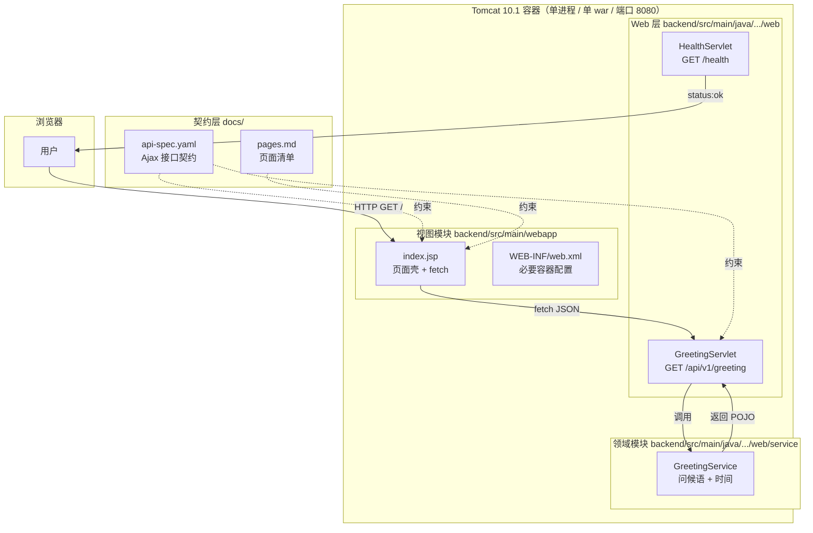
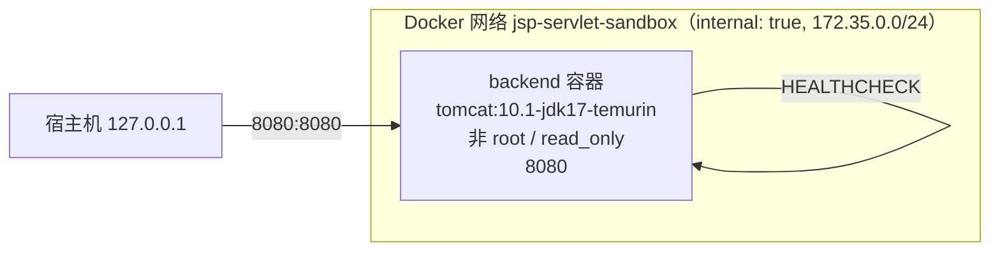

# 架构设计 — JSP + Servlet 最小示例工程

> 本文件是 JSP 遗留栈的架构说明。与 `templates/vue-go/` 最大的差异在 §3「模块划分」：
> **工作归属按目录切分，而不是按"前端/后端"切分**（依据 `docs/03-AI全闭环落地方案.md` §2.4）。

## 1. 技术选型

| 层 | 技术 | 版本 | 理由 |
|---|---|---|---|
| 语言 | Java | 17（LTS） | 容器镜像成熟；`var`/文本块可用；Tomcat 10.1 的原生基线 |
| Web 层 | Jakarta Servlet | 6.0（`jakarta.servlet.*`） | Tomcat 10.1 的实现基线；`@WebServlet` 注解可省去 XML 映射 |
| 视图层 | JSP + JSTL API | 3.1 | 遗留栈现状；本示例只用 JSP 做"壳"，业务数据一律走 Ajax，不在页面里写 Java 逻辑 |
| 构建 | Maven（`war` 打包） | 3.9 | 与 `maven:3.9-eclipse-temurin-17` 镜像一致；`war` 是 Servlet 容器的标准交付形态 |
| 容器 | Tomcat | 10.1（`tomcat:10.1-jdk17-temurin`） | Jakarta EE 9+ 命名空间，是 Servlet 6 的最小可用版本 |
| 测试 | JUnit 5 + Mockito | 5.10 / 5.11 | 领域层纯 POJO 单测，不需要启动容器 |
| 静态检查 | Maven Checkstyle Plugin（可选） | 3.3+ | 模板未预置规则集，`lint.sh` 会自动退化，见 §7 |
| 部署 | Docker 多阶段 + Compose | — | 构建与运行分离，运行镜像不含 Maven 与源码 |
| 序列化 | 手写 JSON（`StringBuilder` + 转义） | — | 示例规模下不引入 Jackson/Gson，减少依赖面；真实项目应换成 Jackson |

> **为什么不用 Spring Boot？** 本模板的目标是"最小可运行 + 依赖最少"，用于验证框架的门禁与
> 模块切分方法在**纯 Servlet** 环境下成立。引入 Spring 会掩盖遗留项目的真实约束。

## 2. 系统架构图



要点：

1. **只有一个进程、一个 war、一个端口。** 页面与接口同源，因此不存在 CORS、不需要反向代理分层。
2. **`index.jsp` 不直接调 service。** 页面只能通过 HTTP 打 Ajax 接口，这样视图与领域之间
   在运行时也是解耦的，视图模块可以被独立替换（换成 Thymeleaf / React 都不影响领域层）。
3. **契约层不在运行链路里，但在协作链路里是硬约束。** 它是两个开发者之间唯一的对齐物。

## 3. 模块划分（按目录切分，明确归属）

### 3.1 归属表

| 模块 | 物理路径 | 归属角色 | 允许的改动 | 禁止的改动 |
|---|---|---|---|---|
| 视图模块 | `backend/src/main/webapp/**` | 视图模块开发者 | 页面、静态资源、`web.xml`、错误页 | `src/main/java/**` |
| Web 适配层 | `backend/src/main/java/com/example/web/*.java` | 视图模块开发者 | Servlet 的参数解析、响应写出、HTTP 状态码 | 业务规则、SQL、领域模型定义 |
| 领域模块 | `backend/src/main/java/com/example/web/{service,dao,model}/**` | 领域模块开发者 | 业务规则、数据访问、模型、领域单测 | `webapp/**`、Servlet 类 |
| 契约 | `docs/api-spec.yaml`、`docs/pages.md` | 架构师 | 契约变更（须评审） | 业务实现 |
| 构建与部署 | `backend/pom.xml`、`backend/Dockerfile`、`deploy/**`、`scripts/**` | 运维 / 架构师 | 构建参数、编排、门禁脚本 | 业务逻辑 |
| 测试与安全 | `tests/**`（**待创建**）、`docs/test/**`（待创建） | 独立测试 / 红队 | 测试用例与报告 | 任何业务代码（只读） |

### 3.2 为什么以目录为边界

| 论点 | 说明 |
|---|---|
| 物理可隔离 | `webapp/**` 与 `java/**/{service,dao,model}/**` 在文件系统上不相交，可用沙箱路径白名单硬隔离（铁律三） |
| 任务可独立验收 | 视图任务验收"页面打开 + Ajax 命中契约"；领域任务验收"单测全绿"。而"前端任务"在本栈里无法独立构建 |
| 无构建期耦合 | 领域模块先编译；视图模块依赖领域模块的**接口签名**，不依赖其实现。改实现不需要通知视图方 |
| 冲突可检测 | 任何 PR 若同时改动两侧路径，评审规则直接标记为"契约变更"，要求先改 `api-spec.yaml` |

### 3.3 两个开发者之间的交接协议

```
架构师改契约（api-spec.yaml / pages.md）
        ↓ 评审通过
拆成两个独立任务（Issue）
        ↓
┌───────────────────────┬───────────────────────┐
│ 视图模块开发者          │ 领域模块开发者          │
│ 实现 Servlet + 页面     │ 实现 service + 单测     │
└───────────────────────┴───────────────────────┘
        ↓ 各自单测通过、各自脚本门禁通过
独立测试 AI 按契约做接口/UI 验证（不读实现）
```

硬规则：

1. **契约先行。** 没有 `api-spec.yaml` 里的字段定义，视图模块不许猜字段名。
2. **不许单侧改契约。** 需要新增字段时，先改契约再改代码，两者在同一 PR 但分两个 commit，
   便于评审区分"契约变更"与"实现变更"。
3. **Servlet 是薄适配层。** 判据不是"文件总行数"，而是 `doGet` 方法体内**没有任何业务条件分支**
   （唯一允许的分支是异常兜底），且不出现字段名以外的业务常量。总行数会随注释与转义工具增长，
   拿它当门禁只会逼人删注释，属于无效度量。

## 4. 数据模型

本示例**没有持久化**，仅返回内存中构造的问候语。目录中预留了 `dao/`、`model/` 包位，但本期为空。

### 4.1 领域对象

| 对象 | 字段 | 类型 | 说明 |
|---|---|---|---|
| `Greeting` | `message` | `String` | 问候语正文，默认 `Hello from JSP backend` |
| | `time` | `String` | ISO-8601 带偏移的时间串，由 `OffsetDateTime` 格式化 |

> `Greeting` 在模板中由 `GreetingService` 直接产出为 `Map`/`String`（演示级实现），
> 真实项目应改为 `model/Greeting.java` 的不可变 POJO。

### 4.2 模型演进预留（未实作）

若后续接数据库，约定如下（供 `dao/` 使用）：

```sql
-- 预留：仅作设计意图说明，本模板不执行任何 DDL
CREATE TABLE greeting (
    id         BIGINT       PRIMARY KEY,
    message    VARCHAR(255) NOT NULL,
    locale     VARCHAR(16)  NOT NULL DEFAULT 'zh-CN',
    created_at TIMESTAMP    NOT NULL
);
```

**数据隔离约束**：隔离环境若启用数据库，必须使用 `tmpfs` 内存卷 + 合成数据，
严禁连接生产库（落地方案 §7.2）。本模板当前无数据库，天然满足。

## 5. 接口契约

| 接口 | 方法 | 说明 | 契约位置 |
|---|---|---|---|
| `/health` | GET | 存活探针，返回 `{"status":"ok"}` | [api-spec.yaml](./api-spec.yaml) |
| `/api/v1/greeting` | GET | 返回 `{message, time}` | [api-spec.yaml](./api-spec.yaml) |
| `/`、`/index.jsp` | GET | 首页 HTML（非 Ajax，但**受页面清单约束**） | [pages.md](./pages.md) |

约定与约束：

1. **`api-spec.yaml` 是接口的唯一事实源。** 响应字段名、类型、示例值以它为准；
   代码与文档不一致时以契约为准，并视为代码缺陷。
2. **JSP 页面本身不进 OpenAPI。** 页面用 `pages.md` 管理，因为 OpenAPI 无法描述
   "这个页面的哪块 DOM 依赖哪个接口的哪个字段"。两份契约互补，缺一不可。
3. **错误响应。** 本期仅约定 HTTP 状态码（400/405/500），不定义统一错误体格式；
   真实项目应补 RFC 7807 `application/problem+json`。
4. **版本化。** 业务接口统一前缀 `/api/v1/`；`/health` 不带版本，属于基础设施端点。

## 6. 非功能设计

| 维度 | 设计 | 落地位置 |
|---|---|---|
| 安全（容器） | 非 root 用户 `tomcat`（UID 1000）运行；根文件系统 `read_only`；`tmpfs` 挂 `/tmp` 与 Tomcat 工作目录 | `Dockerfile` + `deploy/docker-compose.yml` |
| 安全（应用） | 异常不向响应体输出堆栈；`Content-Type` 显式声明并带 `charset=UTF-8`；不反射用户输入到 HTML | `GreetingServlet`、`index.jsp` |
| 安全（依赖） | 依赖面极小（仅 servlet/jsp API 为 `provided`，不进产物）；无第三方运行时依赖 | `pom.xml` |
| 网络 | Compose 网络 `internal: true` + `172.35.0.0/24`；仅映射 `8080` 供本地调试 | `deploy/docker-compose.yml` |
| 资源 | `cpus: "1.0"`、`memory: 512M`；JVM 通过 `CATALINA_OPTS` 限制堆，避免容器 OOM | compose + Dockerfile |
| 可观测 | `/health` 供探针；容器 `HEALTHCHECK` 每 15s 一次；Tomcat 访问日志走 stdout | `Dockerfile`、`runbook.md` §5 |
| 启动时间 | 无数据库、无外部依赖，冷启动目标 ≤ 60s | 实测见 `runbook.md` |
| 编码 | 全链路 UTF-8：`file.encoding`、`response.setCharacterEncoding`、JSP `pageEncoding` | `web.xml`、Servlet、`index.jsp` |
| 会话 | 不使用 HttpSession；无状态，便于水平扩展与探针判定 | 全局约定 |

## 7. 已知技术债与门禁边界（诚实声明）

依据落地方案 §2.4 第 3 点，JSP 遗留栈**不追求现代前端栈的自动化率**。本模板的门禁边界：

| 项目 | 现状 | 说明 |
|---|---|---|
| Lint | `lint.sh` 优先调 `checkstyle:check`；pom 未配置规则集时该目标会失败 → 脚本自动退化为 `mvn compile` 并**打印中文说明** | 不为了凑门禁强塞一套风格规则；规则集应由团队按现有代码基线单独制定 |
| 覆盖率 | 未接入 JaCoCo | 引入覆盖率会要求拆分纯逻辑，属于重构，需单独立项 |
| E2E | `e2e.sh` 为占位，恒 exit 0 | 真正的浏览器级 E2E 需要 Playwright + 容器网络，超出最小模板范围 |
| 静态资源 | 无构建期压缩/指纹 | JSP 项目通常由容器直接服务静态资源 |
| 数据库迁移 | 无 Flyway/Liquibase | 本期无库 |

**这些不是"以后再说"，而是显式登记的技术债**：任何一项要升级，都必须作为独立 Issue 立项，
不允许开发智能体在业务任务里"顺手"改门禁配置来让自己变绿。

## 8. 部署拓扑



单容器、无外部依赖，`docker compose down -v` 即可完全销毁，环境可重复构建。
生产部署与回滚流程见 [runbook.md](./runbook.md) §4。
