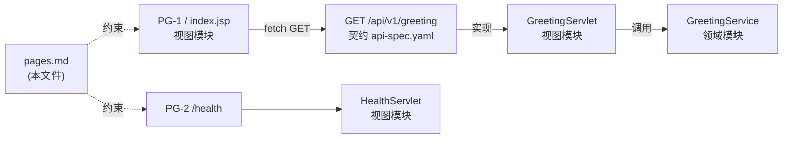

# 页面清单 — JSP + Servlet 示例

> **这是 JSP 项目的第二份契约，与 `api-spec.yaml` 同等重要。**
> OpenAPI 只能描述"接口返回什么"，描述不了"哪个页面的哪块 UI 依赖哪个字段"。
> 在前后端边界模糊的 JSP 栈里，**页面清单是视图模块与领域模块之间、以及视图模块与测试 AI
> 之间的对齐物**。任何新增/修改页面都必须先改本文件，再改代码。

## 1. 使用约定

1. **页面路径**一律写容器内路径（`/` 为 ROOT 上下文），不含 `http://host:port`。
2. **依赖的 Ajax 接口**必须能在 `api-spec.yaml` 中找到；对不上即为契约缺陷。
3. **归属模块**按目录判定，取值只能是：`视图模块`、`领域模块`、`运维`。
   一个页面永远归视图模块——领域模块不产出页面。
4. **渲染方式**区分 SSG（服务端直出，JSP 里写完）与 CSR（浏览器 fetch 后填充）。
   JSP 项目混用很常见，必须逐页标注，否则测试 AI 无法判定"该等 DOM 出现还是等接口返回"。

## 2. 页面清单

| 编号 | 页面路径 | 用途 | 渲染方式 | 依赖的 Ajax 接口 | 归属模块 | 关键契约字段 |
|---|---|---|---|---|---|---|
| PG-1 | `/`、`/index.jsp` | 首页：展示后端返回的问候语，验证页面与接口联通 | CSR（`fetch` 后填充 `#greeting`） | `GET /api/v1/greeting` | 视图模块 | `message`、`time` |
| PG-2 | `/health`（非 HTML） | 存活探针端点，返回 JSON，供运维与脚本使用 | — | 无 | 视图模块（`HealthServlet`） | `status` |
| PG-3 | 容器默认错误页 | 4xx/5xx 时的容器默认错误页 | SSG（容器提供） | 无 | 运维 | — |

> PG-2 严格说不是"页面"，但它是对外暴露的路径，列在此处以保证**所有对外路径都有归属**，
> 避免出现"没人负责的 URL"。

## 3. 页面与模块的对应关系



## 4. 页面明细

### PG-1 首页 `/index.jsp`

| 项 | 内容 |
|---|---|
| 用途 | 演示"页面 → Ajax → service"的完整链路；同时作为冒烟测试的入口 |
| 访问方式 | `GET /` 或 `GET /index.jsp` |
| 渲染容器 | `<div id="greeting">`，初始文案为 `加载中…` |
| 数据来源 | `GET /api/v1/greeting`，读取 `message` 与 `time`；接口地址由 EL 拼上下文路径，非 ROOT 部署也正确 |
| 成功表现 | `#greeting` 文本包含 `Hello from JSP backend`；`#time` 文本为非空时间串 |
| 失败表现 | `#greeting` 文本为 `问候语加载失败`（固定文案，便于断言） |
| 依赖字段 | `message`（必需）、`time`（必需） |
| 归属模块 | 视图模块（`backend/src/main/webapp/index.jsp`） |
| 编码要求 | 页面 `pageEncoding="UTF-8"`，响应头 `charset=UTF-8`，否则中文文案乱码 |
| 不含 | 不含 JSP 脚本片段（scriptlet）中的业务逻辑、不含 SQL、不含会话校验 |

**视图模块验收方法（可被测试 AI 独立执行）**

```bash
# 1. 页面可达
curl -fsS http://localhost:8080/index.jsp | grep -q 'id="greeting"'

# 2. 页面引用的接口在契约中存在
grep -q '/api/v1/greeting' docs/api-spec.yaml

# 3. 接口按契约返回
curl -fsS http://localhost:8080/api/v1/greeting
```

### PG-2 健康检查 `/health`

| 项 | 内容 |
|---|---|
| 用途 | 容器探针、部署门禁、回滚判定 |
| 返回 | `{"status":"ok"}`，`Content-Type: application/json;charset=UTF-8` |
| 依赖 | 无（不查数据库、不查外部服务，只证明 JVM 与 webapp 已就绪） |
| 归属模块 | 视图模块（`HealthServlet`） |
| 备注 | 任何"让健康检查依赖下游服务"的改动都属于架构变更，须评审 |

### PG-3 容器默认错误页

| 项 | 内容 |
|---|---|
| 用途 | 兜底展示 4xx/5xx，避免泄露堆栈 |
| 现状 | 使用 Tomcat 默认错误页；`web.xml` 未自定义 `error-page` |
| 归属模块 | 运维 |
| 待办 | 生产环境建议自定义错误页，禁止回显堆栈与容器版本号 |

## 5. 变更流程

新增或修改页面的标准流程（避免两个开发者互相踩文件）：

1. 架构师更新本文件：新增行、填齐"依赖的 Ajax 接口"与"归属模块"。
2. 若需要新接口，先改 `api-spec.yaml`，再改本文件。
3. 评审通过后，拆成两个独立任务：
   - 视图模块：实现/修改 JSP、Servlet；
   - 领域模块：若接口需要新业务能力，实现 service 与单测。
4. 两侧均通过各自门禁后，由独立测试 AI 按本文件的"页面明细"逐项验证。

> **禁止**：在未更新本文件的情况下新增页面或新增 Ajax 调用。这类改动会让页面清单失真，
> 直接破坏"契约先行"，评审应驳回。

## 6. 待补充页面（本期不做）

| 计划页面 | 说明 | 前置条件 |
|---|---|---|
| `/error.jsp` | 自定义错误页 | 需要 `web.xml` 配置 `error-page` |
| `/greeting/list.jsp` | 问候语列表 | 需要 DAO 与数据库（当前无） |
| `/login.jsp` | 登录 | 需要认证方案设计（当前范围之外） |
