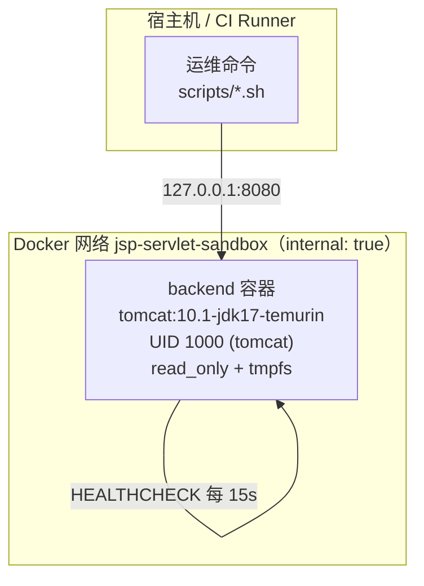

# 运维实施文档（Runbook）— JSP + Servlet 示例

> 硬交付物，不是附带说明（框架落地方案 §4）。
> 判据：**任何一个新智能体或新人，只读本仓库，能否从零重建环境并判断它是否健康？**
> 不能，就是没交付。

| 项 | 内容 |
|---|---|
| 服务名 | `jsp-servlet-demo` |
| 交付形态 | 单个 `.war`（编译后部署为 Tomcat 的 `ROOT` 上下文） |
| 运行基线 | Java 17 + Tomcat 10.1（Jakarta EE 9+） |
| 对外端口 | `8080` |
| 环境 | `dev` / `staging`（隔离）/ `prod`（人工审批后发布） |
| 文档版本 | v0.1.0（随模板初始化） |

---

## 1. 环境架构

### 1.1 拓扑



### 1.2 环境分级

| 环境 | 用途 | 数据 | 凭证 | 生命周期 |
|---|---|---|---|---|
| dev | 开发者本地自测 | 无持久化 | 无 | 随时重建 |
| staging | 集成 / 功能 / 安全 / 性能测试 | 无持久化（`read_only` + `tmpfs`） | 仅测试值 | 一次性，`down -v` 即销毁 |
| prod | 生产 | 按业务需要（本模板无库） | 生产密钥，**不进任何测试流水线** | 长期，发布需人工审批 |

> 生产是"只读禁地"：自动化只允许读监控与日志，绝不写（落地方案 §7.5）。

### 1.3 组件清单

| 组件 | 说明 | 是否可省略 |
|---|---|---|
| Tomcat 10.1 | Servlet/JSP 容器，`ROOT.war` 部署为根上下文 | 否 |
| JVM（Temurin 17） | 运行环境，含 `-XX:MaxRAMPercentage` 限制 | 否 |
| Docker / Compose | 构建与编排 | 本地裸机 Tomcat 部署时可省 |
| 反向代理（Nginx 等） | 生产通常需要 TLS 终止与限流 | 示例中省略，生产建议加 |

---

## 2. 依赖与前置条件

### 2.1 工具链版本

| 工具 | 最低版本 | 校验命令 | 缺失后果 |
|---|---|---|---|
| Docker Engine | 24.x | `docker version` | 无法构建镜像 |
| Docker Compose | v2（`docker compose`） | `docker compose version` | 无法一键启动 |
| Maven | 3.9.x | `mvn -v` | `scripts/*.sh` 相关门禁失败 |
| JDK | 17（LTS） | `java -version` | 编译失败（`release 17` 不识别） |
| curl | 任意 | `curl --version` | `scripts/health.sh` 失败 |
| bash | 4.x | `bash --version` | 脚本无法执行（Windows 用 Git Bash / WSL） |

> 本模板的脚本在工具缺失时会**打印明确中文提示并以非 0 退出**，不会静默通过。
> 这是门禁可信的前提——"命令不存在"绝不能被当成"检查通过"。

### 2.2 构建期依赖（Maven 会自行下载）

| 依赖 | 版本策略 | 说明 |
|---|---|---|
| `jakarta.servlet:jakarta.servlet-api` | `provided`，`6.0.0` | 由 Tomcat 提供，**不进 war** |
| `jakarta.servlet.jsp:jakarta.servlet.jsp-api` | `provided`，`3.1.0` | 同上；JSP 编译由容器负责 |
| `org.junit.jupiter:junit-jupiter` | `5.10.x` | 仅测试作用域 |
| `org.mockito:mockito-core` | `5.11.x` | 仅测试作用域 |

### 2.3 运行时前置条件

- 容器端口 `8080` 在宿主机空闲。
- 无需数据库、无需外部 API、无需消息队列（当前版本）。
- 生产部署需要：目标主机已装 Tomcat 10.1、`CATALINA_HOME` 可写 `webapps/`、JVM 参数可注入。

---

## 3. 构建步骤

### 3.1 本地构建（产出 war）

```bash
# 从模板根目录执行；脚本会自行定位 backend/
bash scripts/build.sh

# 等价手工命令
cd backend && mvn -q -B clean package -DskipTests

# 校验产物
ls -lh backend/target/ROOT.war
unzip -l backend/target/ROOT.war | head        # 应包含 WEB-INF/web.xml 与 index.jsp
```

### 3.2 构建镜像

```bash
cd backend
docker build -t jsp-servlet-demo:0.1.0 .
# 多阶段：maven:3.9-eclipse-temurin-17 构建 → tomcat:10.1-jdk17-temurin 运行
```

### 3.3 构建产物校验清单

| 检查项 | 命令 | 期望 |
|---|---|---|
| war 存在 | `test -f backend/target/ROOT.war` | exit 0 |
| 必要文件在包内 | `unzip -l ... \| grep -E 'index.jsp\|WEB-INF/web.xml'` | 两行均命中 |
| 未打包 Servlet API | `unzip -l ... \| grep -c 'jakarta/servlet'` | `0` |
| 镜像大小 | `docker images jsp-servlet-demo` | < 500 MB（基线镜像约 280 MB） |
| 非 root | `docker inspect -f '{{.Config.User}}' jsp-servlet-demo:0.1.0` | `tomcat` 或 `1000` |

### 3.4 构建失败常见原因

| 现象 | 原因 | 处置 |
|---|---|---|
| `package jakarta.servlet does not exist` | 依赖写成了 `javax.servlet` | 改回 `jakarta.*`（Tomcat 10.1 不认 javax） |
| `invalid target release: 17` | JDK 版本过低 | 升级 JDK 或改 `<maven.compiler.release>`（不推荐降级） |
| `Could not resolve dependencies` | 无网络 / 私服不可达 | 配置 `~/.m2/settings.xml` 镜像 |
| war 里出现 `jakarta.servlet-api.jar` | 作用域漏写 `provided` | 检查 `pom.xml` |

---

## 4. 部署步骤（含回滚）

### 4.1 隔离环境（staging）一键部署

```bash
cd deploy
docker compose up -d --build
docker compose ps                       # 等待 backend 状态为 healthy
bash ../scripts/health.sh               # 部署后门禁
```

### 4.2 裸机 Tomcat 部署（生产形态）

```bash
# 1. 备份当前版本（回滚依赖这一步，不可省）
STAMP=$(date +%Y%m%d%H%M%S)
cp "$CATALINA_HOME"/webapps/ROOT.war "/opt/backup/ROOT-$STAMP.war"

# 2. 停服（优雅停止，等待在途请求结束）
"$CATALINA_HOME"/bin/shutdown.sh || true
sleep 5

# 3. 替换产物（先删展开目录，避免新旧文件混杂）
rm -rf "$CATALINA_HOME"/webapps/ROOT
cp backend/target/ROOT.war "$CATALINA_HOME"/webapps/ROOT.war

# 4. 启动
"$CATALINA_HOME"/bin/startup.sh

# 5. 健康检查（最多等 90s）
for i in $(seq 1 18); do
  curl -fsS http://127.0.0.1:8080/health && break
  sleep 5
done
```

### 4.3 部署门禁

| 判定项 | 通过标准 | 失败动作 |
|---|---|---|
| 容器/进程存活 | `/health` 返回 200 且 `status=ok` | 立即回滚 |
| 启动耗时 | ≤ 60s 到 healthy | 观察 1 次；连续 2 次超时则回滚 |
| 页面可达 | `GET /` 返回 200 | 回滚 |
| 日志无致命错误 | 无 `SEVERE`/`OutOfMemoryError` | 回滚 |
| 人工审批 | 生产发布前已完成 | 终止发布 |

### 4.4 回滚

```bash
# 回滚 = 用备份 war 覆盖并重启
"$CATALINA_HOME"/bin/shutdown.sh || true
sleep 5
rm -rf "$CATALINA_HOME"/webapps/ROOT
cp /opt/backup/ROOT-<最近一次稳定时间戳>.war "$CATALINA_HOME"/webapps/ROOT.war
"$CATALINA_HOME"/bin/startup.sh
bash scripts/health.sh
```

Docker 形态回滚：

```bash
docker compose down
docker tag jsp-servlet-demo:<上一稳定tag> jsp-servlet-demo:current
docker compose up -d        # 注意：compose 需指向 :current 或指定 image
```

**回滚纪律**：

1. 回滚必须保留现场：先 `docker logs` / 拷贝 `logs/` 再覆盖（落地方案 §6.3）。
2. 回滚后仍不健康 → 立即告警并停止自动重试，交由人工判断。
3. 数据库变更（本期无）不可回滚的部分必须前向修复，禁止"回滚 war + 不回滚 schema"。

### 4.5 发布窗口与变更记录

- 每次发布必须记录版本、变更点、回滚点（写入项目根目录的 `CHANGELOG.md`；
  本模板尚未创建该文件，首次发布前应补上）。
- 生产发布采用人工审批（GitHub Environments Required reviewers）。

---

## 5. 健康检查与监控指标

### 5.1 探针

| 探针 | 路径 | 判定 | 频率 | 用途 |
|---|---|---|---|---|
| Liveness | `GET /health` | 200 且 body 含 `"status":"ok"` | 15s | 决定是否重启容器 |
| Readiness | `GET /health` | 同上 | 15s | 决定是否摘流量 |
| Startup | `GET /health` | 首次成功即通过 | 5s，最多 90s | 防止慢启动被误杀 |

> 本示例的 `/health` 同时承担 liveness 与 readiness。若后续依赖数据库，
> **必须拆成两个端点**：liveness 不查下游，readiness 才查。

容器内置 HEALTHCHECK（见 `backend/Dockerfile`）：

```bash
docker inspect -f '{{.State.Health.Status}}' <container>
```

### 5.2 关键指标

| 指标 | 来源 | 告警阈值（建议） | 说明 |
|---|---|---|---|
| `/health` 失败次数 | 探针 / 外部监控 | 连续 3 次 | 立即告警 |
| HTTP 5xx 比例 | Tomcat access log | > 1% 持续 5 min | 应用异常 |
| P95 响应时间 | access log | > 500 ms | 性能退化 |
| JVM 堆使用率 | JMX / `jcmd` | > 85% 持续 10 min | 存在 OOM 风险 |
| Full GC 次数 | GC 日志 | > 5 次/小时 | 内存配置不足 |
| 容器重启次数 | `docker inspect` | > 1 次/小时 | 崩溃循环 |
| CPU 使用率 | `docker stats` | > 80% 持续 10 min | 资源不足或死循环 |

### 5.3 日志

| 日志 | 位置 | 采集方式 |
|---|---|---|
| Tomcat 访问日志 | stdout（容器） | 采集器按行抓取 |
| Tomcat 应用日志 | `$CATALINA_BASE/logs/catalina.out` | 容器中重定向到 stdout |
| 容器日志 | `docker logs <container>` | 本地排查用 |

**不要在日志里打印**：完整请求头、Cookie、任何凭证、用户身份证/手机号等敏感字段。

---

## 6. 故障排查手册

> 排查顺序固定：**先确认服务是否活着 → 再看是什么变了 → 最后才怀疑代码**。
> 90% 的"部署失败"是配置/环境差异，不是业务缺陷。

### 6.1 症状 → 处置

| 症状 | 可能原因 | 排查命令 | 处置 |
|---|---|---|---|
| 容器反复重启 | JVM 参数错误 / 端口冲突 / war 损坏 | `docker logs <c> --tail 100` | 修正 `CATALINA_OPTS`；检查 `8080` 占用 |
| `/health` 返回 404 | webapp 未解包完成 / 部署到非 ROOT 上下文 | `docker exec <c> ls webapps/` | 等待解包；核对上下文路径 |
| `/health` 返回 500 | Servlet 初始化异常 | `docker logs <c> \| grep SEVERE` | 看首次异常栈，通常是类缺失或依赖冲突 |
| 页面中文乱码 | 编码链断（`pageEncoding` / `setCharacterEncoding` / `file.encoding`） | `curl -I` 看 `Content-Type` | 三处统一 UTF-8 |
| `ClassNotFoundException: jakarta.servlet.*` | 用了 Tomcat 9 或 `javax` 依赖 | `docker exec <c> catalina.sh version` | 换 Tomcat 10.1 / 改依赖坐标 |
| war 部署后 404 且无日志 | war 结构与 `web.xml` 不合法 | 解包看 `WEB-INF/web.xml` | 校验 XML；看 `catalina.out` |
| 启动极慢（> 90s） | 熵不足 / 类扫描过多 | `docker stats`、`jcmd <pid> VM.system_properties` | 增 `-Djava.security.egd`；精简依赖 |
| `read_only` 导致启动失败 | tmpfs 挂载点未创建 / 缺 `/tmp` 或 Tomcat 工作目录 | `docker logs` 看 `Read-only file system` 或 `Permission denied` | 确认 `Dockerfile` 已 `mkdir` 全部挂载点，且 compose 的 `tmpfs` 带 `uid=1000,gid=1000` |
| OOMKilled（exit 137） | 堆超容器上限 | `docker inspect` 看 `OOMKilled` | 调 `MaxRAMPercentage` 或提内存限额 |

### 6.2 常用诊断命令

```bash
# 容器状态与健康
docker compose ps
docker inspect -f '{{json .State.Health}}' <container> | head

# 快速判断是应用问题还是网络问题
curl -v http://localhost:8080/health
docker exec <container> curl -fsS http://localhost:8080/health

# JVM 现场
# 注意：容器是 read_only，只能往 tmpfs 目录（/tmp 或 $CATALINA_HOME/temp）写文件
docker exec <container> jcmd 1 VM.system_properties
docker exec <container> jcmd 1 GC.heap_info
docker exec <container> sh -c 'jstack 1 > /tmp/threads.txt'
docker cp <container>:/tmp/threads.txt ./threads.txt   # 再取到宿主机分析

# 包内容核对
unzip -l backend/target/ROOT.war | grep -E 'index.jsp|web.xml'
```

### 6.3 升级条件

| 条件 | 动作 |
|---|---|
| 15 分钟内无法定位 | 升级给架构师，附日志与复现步骤 |
| 涉及数据不一致 | **停止自动处置**，转人工 |
| 回滚后仍不健康 | 立即告警，冻结该环境 |
| 疑似安全事件 | 按安全预案隔离环境，保留现场，不自行清理 |

---

## 7. 备份与恢复

### 7.1 需要备份什么

| 对象 | 是否需备份 | 说明 |
|---|---|---|
| 应用产物（`ROOT.war`） | 是 | 建议保留最近 3 个稳定版本 |
| 配置文件（`web.xml`、JVM 参数、compose 文件） | 是 | 随 Git 管理，镜像内不另存 |
| 日志 | 按需 | 排障用，保留 7–30 天 |
| 数据库 | 本期无 | 无持久化组件，无需备份 |
| 用户上传文件 | 本期无 | 若后续增加，必须外置到挂载卷 |

### 7.2 备份操作

```bash
# 版本产物备份（每次发布前）
STAMP=$(date +%Y%m%d%H%M%S)
mkdir -p /opt/backup
cp backend/target/ROOT.war "/opt/backup/ROOT-$STAMP.war"
sha256sum "/opt/backup/ROOT-$STAMP.war" >> /opt/backup/SHA256SUMS

# 配置备份（以 Git 提交号为准，避免"配置漂移"）
git rev-parse HEAD > /opt/backup/git-commit.txt
```

### 7.3 恢复流程

```bash
# 1. 确认目标版本
cat /opt/backup/SHA256SUMS | tail -5

# 2. 校验完整性（防备份文件损坏）
sha256sum -c /opt/backup/SHA256SUMS

# 3. 按 §4.4 回滚流程覆盖 war 并重启

# 4. 恢复后必须验证
bash scripts/health.sh
```

### 7.4 恢复演练

| 项 | 要求 |
|---|---|
| 频率 | 每季度至少 1 次 |
| 方式 | 在隔离环境用备份产物重建，不碰生产 |
| 通过标准 | 从零到 healthy ≤ 5 分钟，且 `/health`、`/` 均正常 |
| 记录 | 演练结论写入 `docs/test/` 下的报告 |

---

## 8. 凭证与权限清单

### 8.1 凭证清单

| 凭证 | 用途 | 存放位置 | 轮换周期 | 备注 |
|---|---|---|---|---|
| （无） | 本模板不含任何凭证 | — | — | 无数据库、无外部 API |
| 私有 Maven 仓库账号 | 依赖拉取 | CI Secrets / `~/.m2/settings.xml` | 90 天 | 仅构建期使用，**不进镜像** |
| 镜像仓库推送令牌 | 推送镜像 | CI Secrets | 90 天 | 只读+推送权限，不含删除 |
| 生产主机 SSH 密钥 | 部署 | 堡垒机 / 密钥管理服务 | 180 天 | 禁止个人密钥直连 |

**硬规则**（落地方案 §7.1）：

1. 生产密钥**绝不注入** dev/staging，物理隔离（不同 secrets / 不同云账号）。
2. 任何凭证不得写入仓库、镜像层、Dockerfile、compose 文件、日志。
3. 发现凭证泄露：立即轮换 → 排查使用记录 → 记录事件 → 通知安全负责人。

### 8.2 权限矩阵

| 角色 | 构建 | 部署 staging | 部署 prod | 读日志 | 改配置 | 回滚 |
|---|---|---|---|---|---|---|
| 开发智能体 | ✅ | ❌ | ❌ | staging ✅ | ✅（经 PR） | ❌ |
| 运维智能体 | ✅ | ✅ | ✅（人工审批后） | ✅ | ✅ | ✅ |
| 测试 / 安全 | ❌ | ❌（只读环境） | ❌ | staging ✅ | ❌ | ❌ |
| 人类审批者 | — | — | ✅ 批准 | ✅ | ✅ | ✅ |

### 8.3 容器运行权限

| 项 | 设置 | 目的 |
|---|---|---|
| 运行用户 | `tomcat`（UID 1000），非 root | 降低逃逸影响面 |
| 根文件系统 | `read_only: true` | 阻止落盘与植入 |
| 可写目录 | `tmpfs`：`/tmp`、`/usr/local/tomcat/temp`、`/usr/local/tomcat/work` | 仅内存可写，重启即清空 |
| 提权 | `no-new-privileges:true` | 禁止 setuid 提权 |
| Capabilities | 默认丢弃（不加 `cap_add`） | 最小能力集 |
| 资源 | `cpus: "1.0"`、`memory: 512M` | 防单容器拖垮宿主 |

### 8.4 变更审计

- 所有部署操作留痕：谁、何时、什么版本、结果如何。
- 生产变更必须关联 Issue 与 PR。
- 回滚同样记入 `CHANGELOG.md`（首次发布前先创建该文件）。

---

> 本 runbook 与 `docs/architecture.md`、`docs/api-spec.yaml`、`docs/pages.md` 配套。
> 任何部署形态变更（加库、加反代、换容器版本）都必须同步更新本文档，否则视为交付不完整。
