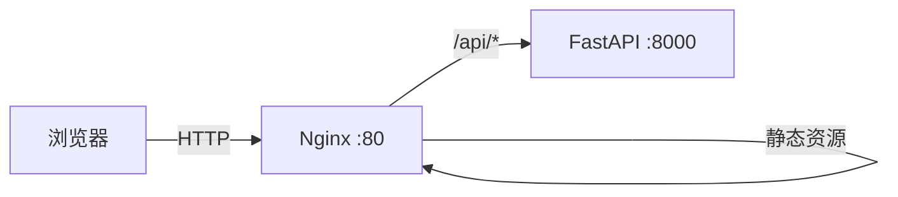

# 架构设计 — React + Python 最小示例工程

## 1. 技术选型

| 层 | 技术 | 理由 |
|---|---|---|
| 前端 | React 18 + TypeScript + Vite | 生态最大，类型安全，构建快 |
| 后端 | Python 3.12 + FastAPI | 自动生成 OpenAPI，pydantic 契约校验 |
| 测试 | 前端 Vitest + Testing Library / 后端 pytest | 原生单测 |
| 部署 | Docker + Nginx | 前端静态托管 + 反代 API |

## 2. 系统架构图

## 3. 模块划分

- `backend/app/main.py` — 应用入口 + 中间件
- `backend/app/routers/greeting.py` — 问候路由
- `frontend/src` — React 组件、API 客户端

## 4. 数据模型

无持久化数据库，仅内存返回问候语。

## 5. 接口契约

见 [api-spec.yaml](./api-spec.yaml)。

## 6. 非功能设计

- 后端非 root 用户、slim 镜像。
- 前端产物 Nginx 托管、反代后端。
