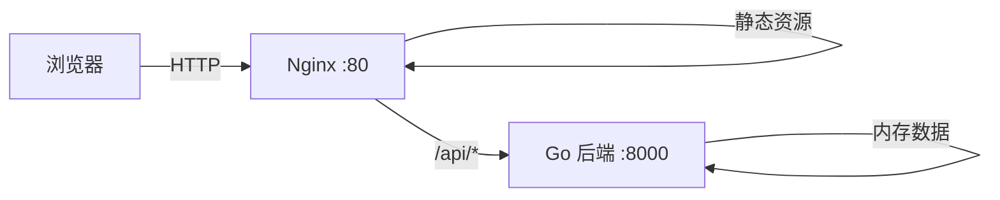

# 架构设计 — Vue + Go 最小示例工程

## 1. 技术选型

| 层 | 技术 | 理由 |
|---|---|---|
| 前端 | Vue 3 + TypeScript + Vite | 生态成熟，类型安全，构建快 |
| 后端 | Go 1.22 + net/http | 标准库即可满足，部署为静态二进制，镜像最小 |
| 测试 | 前端 Vitest / 后端 go test | 原生单测，无需额外服务 |
| 部署 | Docker + Nginx | 前端静态托管 + 反代 API |

## 2. 系统架构图

## 3. 模块划分

- `backend/cmd/server` — 入口
- `backend/internal/api` — 路由与 handler
- `frontend/src` — Vue 组件、API 客户端

## 4. 数据模型

本示例无持久化数据库，仅内存返回问候语。

## 5. 接口契约

见 [api-spec.yaml](./api-spec.yaml)。

## 6. 非功能设计

- 后端以非 root 用户运行、最小镜像。
- 前端产物由 Nginx 托管，反向代理后端。
